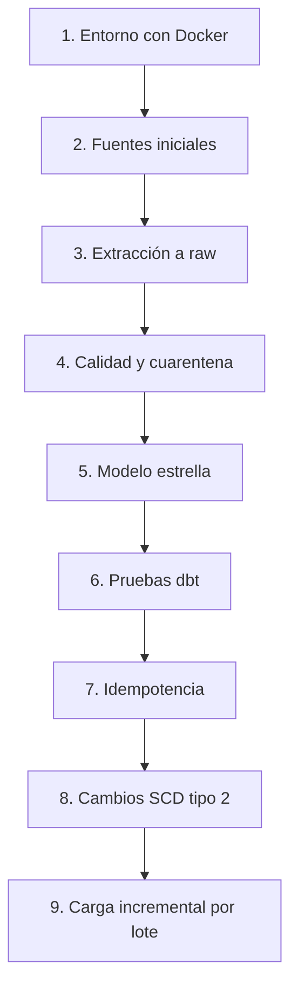

# Data warehouse local de comercio electrónico colombiano

PoC reproducible de ventas. Genera datos sintéticos en MySQL y MongoDB, los carga en DuckDB y construye una constelación de hechos con dbt. Airflow orquesta la extracción y las transformaciones; los scripts preparan y operan el entorno.

Este README es el índice. Cada etapa tiene su guía en [docs/etapas/](docs/etapas/) con los comandos, el resultado esperado, las consultas para DBeaver o Compass y los archivos que intervienen.

## Ruta de aprendizaje



## Requisitos

- Windows con Docker Desktop y WSL 2, o Docker Engine con Compose v2 en Linux.
- Ejecutar los comandos desde la raíz del repositorio, dentro de WSL o de la terminal Linux.
- Puertos libres: 8080 (Airflow, `AIRFLOW_UI_PORT`), 3306 (MySQL), 27017 (MongoDB) y 5433 (PostgreSQL de Airflow, `POSTGRES_HOST_PORT`).
- DBeaver y MongoDB Compass para inspeccionar resultados. Cómo conectarlos está en [docs/connections.md](docs/connections.md).
- No hace falta instalar Python ni dbt en el equipo: la imagen de Docker los contiene.

## Inicio rápido

```bash
./scripts/configure_environment.sh
./scripts/run_pipeline.sh
```

El primer comando crea `.env` desde `docker/.env.example`. El segundo levanta los servicios, crea las fuentes, genera datos y dispara el DAG `ecommerce_pipeline`. La primera ejecución tarda más porque construye la imagen de Airflow.

Para recorrer las etapas una a una, sigue las guías en orden, empezando por [01_entorno](docs/etapas/01_entorno.md).

## Etapas

| # | Etapa | Qué compruebas | Guía |
| --- | --- | --- | --- |
| 1 | Entorno | Servicios activos, Airflow accesible y conexiones a las fuentes | [01_entorno.md](docs/etapas/01_entorno.md) |
| 2 | Fuentes iniciales | Tablas y colecciones creadas, con datos sintéticos y defectos inyectados | [02_fuentes_iniciales.md](docs/etapas/02_fuentes_iniciales.md) |
| 3 | Extracción a raw | Copia completa de las fuentes en el esquema `raw` de DuckDB | [03_extraccion_raw.md](docs/etapas/03_extraccion_raw.md) |
| 4 | Calidad y cuarentena | Filas válidas en `intermediate` y rechazadas en `quarantine`, con motivo | [04_calidad_cuarentena.md](docs/etapas/04_calidad_cuarentena.md) |
| 5 | Modelo estrella | Dimensiones, snapshots y hechos en `marts` | [05_modelo_estrella.md](docs/etapas/05_modelo_estrella.md) |
| 6 | Pruebas dbt | Pruebas de unicidad, relaciones, valores y totales | [06_pruebas.md](docs/etapas/06_pruebas.md) |
| 7 | Idempotencia | Repetir el pipeline no cambia los conteos | [07_idempotencia.md](docs/etapas/07_idempotencia.md) |
| 8 | Cambios SCD tipo 2 | Un cliente y un producto conservan su historia | [08_cambios_scd2.md](docs/etapas/08_cambios_scd2.md) |
| 9 | Carga incremental | Cada lote agrega filas a los tres hechos y repetirlo no cambia nada | [09_carga_incremental.md](docs/etapas/09_carga_incremental.md) |

## Operación

| Objetivo | Comando |
| --- | --- |
| Levantar servicios sin regenerar fuentes | `./scripts/start_infrastructure.sh` |
| Detener servicios conservando datos | `./scripts/stop_infrastructure.sh` |
| Crear tablas MySQL y colecciones MongoDB | `./scripts/create_source_schema.sh` |
| Regenerar datos sintéticos | `./scripts/generate_data.sh` |
| Ejecutar el pipeline sin regenerar fuentes | `./scripts/run_pipeline.sh --existing-sources` |
| Ejecutar dbt completo sobre el warehouse existente | `./scripts/run_dbt.sh` |
| Borrar contenedores, volúmenes y datos locales | `./scripts/reset_environment.sh` |

`run_pipeline.sh` sin argumentos ya ejecuta `start_infrastructure.sh`, `create_source_schema.sh` y `generate_data.sh`; no hace falta llamarlos antes. Sin `--existing-sources`, cada ejecución regenera las fuentes y elimina los lotes incrementales añadidos.

## Reglas para el laboratorio

- DuckDB admite un solo escritor. Cierra la conexión de DBeaver antes de ejecutar el pipeline, o conéctate en modo solo lectura.
- Los conteos de las guías corresponden a los valores por defecto (`--seed 42`) tras `reset_environment.sh` y `run_pipeline.sh`.
- Si un conteo no coincide, revisa la etapa anterior antes de continuar.
- `verify_incremental_load.sh --batch-id N` necesita un `N` que todavía no exista en las fuentes. Tras regenerar los datos, todos los números de lote vuelven a estar libres.

## Modelo y documentación de referencia

- [Arquitectura y flujo de datos](docs/architecture.md)
- [Modelo de datos: estrella, SCD tipo 2, llaves subrogadas y fuentes](docs/data_model.md)
- [Orquestación con Airflow](docs/airflow.md)
- [Conexión desde DBeaver y Compass](docs/connections.md)
- [Consultas analíticas de ejemplo](docs/analytical_queries.sql)
