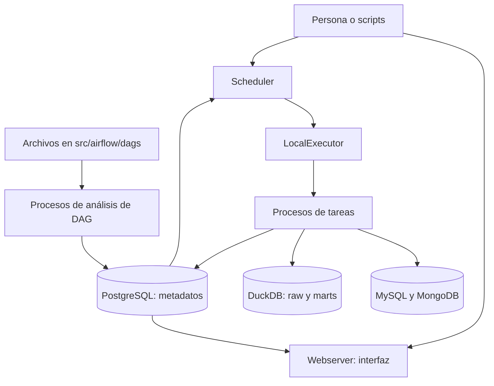
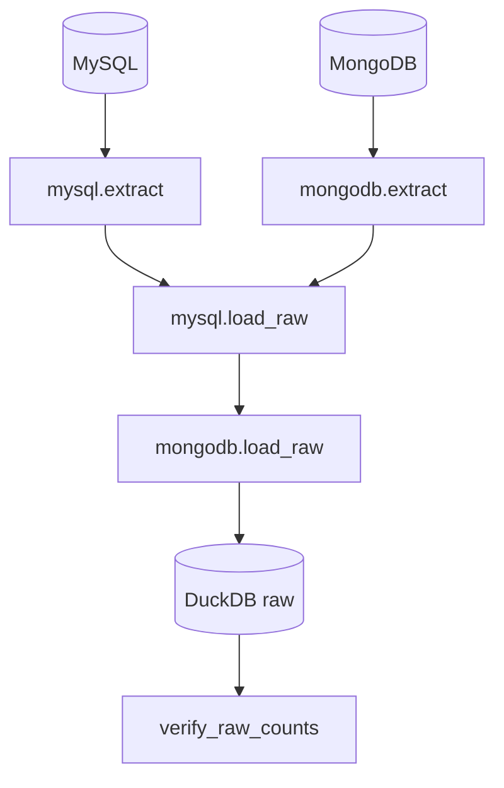
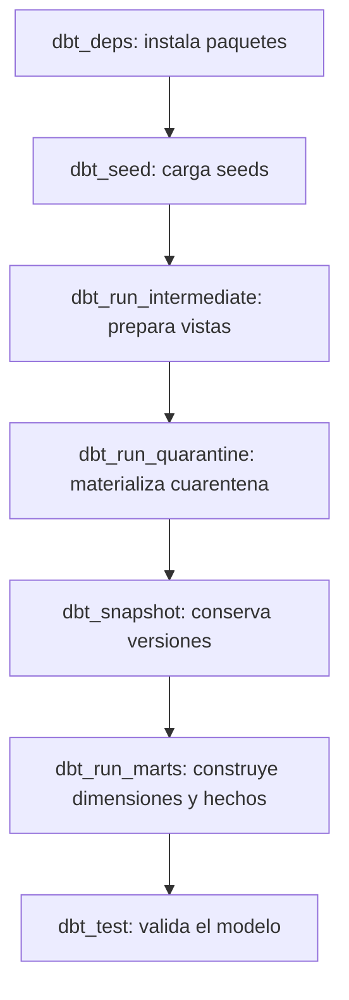
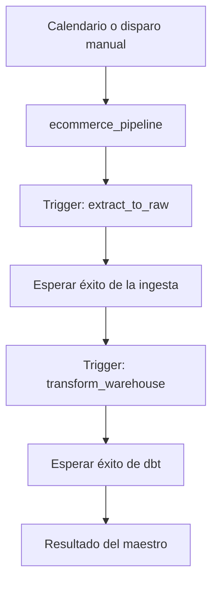

# Orquestación con Airflow

Este proyecto usa Apache Airflow 2.11.2 para coordinar dos trabajos: extraer datos de MySQL y MongoDB hacia la capa `raw` de DuckDB, y construir el warehouse con dbt. La preparación de las fuentes, la generación de datos y la simulación de cambios se hacen con scripts independientes. Airflow puede repetir una carga sobre las fuentes existentes; una corrida programada no genera pedidos nuevos por sí sola.

## Qué representa un DAG

Un **DAG** (*directed acyclic graph*) declara tareas y dependencias sin ciclos. La definición describe qué puede empezar, qué debe esperar y cómo se tratan los fallos; no equivale a una ejecución. Cada disparo crea una **DAG run** y, dentro de ella, una **task instance** para cada tarea. Por eso una misma tarea puede aparecer muchas veces en la interfaz: una instancia distinta por corrida, cada una con estado, intentos y logs propios.

Un **operador** define el tipo de trabajo de una tarea: `PythonOperator` invoca una función Python y `TriggerDagRunOperator` inicia otro DAG. Al declarar un operador dentro del DAG se crea la tarea; al ejecutarse el DAG se crea una instancia de esa tarea.

Una dependencia como `extract >> load` exige que `extract` termine correctamente antes de iniciar `load`. Dos tareas sin dependencia entre sí pueden ejecutarse a la vez si el ejecutor dispone de capacidad. Una instancia puede estar en espera, en ejecución, en reintento, finalizada con éxito o fallida. Si una tarea falla definitivamente, sus dependientes quedan sin ejecutarse por esa dependencia; el estado de la DAG run refleja el resultado final de sus tareas terminales. Los archivos de [`src/airflow/dags/`](../src/airflow/dags/) declaran únicamente DAGs, operadores y dependencias. Las funciones que acceden a datos viven en [`src/ecommerce_dw/`](../src/ecommerce_dw/); `PYTHONPATH=/opt/airflow/src` permite importarlas dentro de los contenedores. Mantener la lógica fuera de los archivos de DAG evita que el análisis periódico de definiciones ejecute trabajo de extracción o transformación. [Conceptos de DAG de Airflow](https://airflow.apache.org/docs/apache-airflow/2.11.0/core-concepts/dags.html).

## Componentes y recorrido de una corrida

| Componente | Función concreta aquí |
| --- | --- |
| `airflow-webserver` | Sirve la interfaz, muestra DAGs, estados y logs, y permite disparar corridas. El puerto del anfitrión se define con `AIRFLOW_UI_PORT` en `.env` y vale 8080 por defecto. No ejecuta las transformaciones. |
| `airflow-scheduler` | Observa la programación, registra corridas y decide qué tareas están listas. Contiene el ejecutor configurado. |
| Procesos de análisis de DAG | Leen periódicamente los tres archivos Python, construyen sus definiciones y las registran para el scheduler y la interfaz. En esta instalación forman parte del servicio del scheduler; no hay un contenedor separado. |
| `LocalExecutor` y procesos de tareas | El ejecutor inicia procesos locales dentro del contenedor del scheduler. Permite que tareas independientes corran en paralelo. No existe un servicio separado de workers ni se usan Redis o Celery. |
| PostgreSQL | Es la base de metadatos de Airflow: definiciones registradas, DAG runs, task instances, usuarios y XCom. No contiene las ventas del warehouse. |
| Carpeta de DAGs y código compartido | Compose monta `src/airflow/dags/` en `/opt/airflow/dags` y `src/` en `/opt/airflow/src`. Los procesos de tareas importan desde ahí las funciones reutilizables. |
| MySQL, MongoDB y DuckDB | MySQL y MongoDB son fuentes; `warehouse/warehouse.duckdb` es el archivo del warehouse compartido con los contenedores de Airflow. |

Al iniciar una corrida, el scheduler consulta las definiciones y estados en PostgreSQL, identifica tareas cuyas dependencias ya se cumplieron y las entrega a `LocalExecutor`. Cada proceso ejecuta la función indicada por su operador, informa su resultado a la base de metadatos y deja logs para la interfaz. El webserver muestra esos estados; no es quien decide el orden ni quien escribe en DuckDB. [Arquitectura de Airflow 2.11](https://airflow.apache.org/docs/apache-airflow/2.11.0/core-concepts/overview.html) y [LocalExecutor](https://airflow.apache.org/docs/apache-airflow/2.11.0/core-concepts/executor/local.html).

`airflow-init` solo prepara la base de metadatos y el usuario administrador cuando se inicia la infraestructura. Su terminación correcta es esperada: no es un proceso permanente. Los servicios que permanecen activos son el webserver, el scheduler y las tres bases de datos.

`LocalExecutor` encaja aquí porque todos los servicios corren en una sola máquina y permite simultanear las dos extracciones sin añadir cola de mensajes ni workers remotos. PostgreSQL sigue siendo necesario para coordinar y conservar los estados de Airflow. Un ejecutor distribuido aportaría capacidad en varios hosts, pero añadiría componentes que este volumen de datos no necesita.

## Programación, fecha lógica y `catchup`

[`ecommerce_pipeline`](../src/airflow/dags/ecommerce_pipeline.py) es el único DAG con calendario propio. `schedule="0 6 * * *"` significa una corrida diaria a las 06:00 de `America/Bogota`. `start_date=2025-01-01` fija el límite inicial para calcular intervalos; no ordena ejecutar el DAG en cuanto arranca Airflow. Una corrida programada se crea cuando termina el intervalo de datos correspondiente. Su **fecha lógica** identifica el comienzo de ese intervalo, por lo que puede ser anterior a la hora real de ejecución. Por ejemplo, una corrida iniciada después de las 06:00 puede representar el intervalo diario que acaba de terminar. [Intervalos y corridas de Airflow](https://airflow.apache.org/docs/apache-airflow/2.11.0/core-concepts/dag-run.html).

`catchup` decide qué hacer con los intervalos programados que quedaron pendientes desde `start_date` o durante una pausa:

| Configuración | Resultado al activar un DAG diario con varios intervalos pendientes |
| --- | --- |
| `catchup=True` | El scheduler puede crear una corrida por cada intervalo pendiente. Sirve cuando el trabajo procesa exactamente el intervalo asociado a cada corrida. |
| `catchup=False` | El scheduler crea solo la corrida correspondiente al intervalo más reciente y continúa con las futuras. No forma una cola de todos los días anteriores. |

Aquí `catchup=False` evita decenas o cientos de corridas al iniciar el proyecto con una fecha antigua. Tiene sentido porque la ingesta lee el estado **actual y completo** de las fuentes, no filtra filas por la fecha lógica de cada corrida. `catchup=False` no bloquea un disparo manual ni una recuperación histórica solicitada expresamente mediante las herramientas de Airflow. `max_active_runs=1` impide que dos corridas del DAG maestro estén activas al mismo tiempo. Una corrida programada y una manual siguen siendo corridas distintas; ambas usan las mismas tareas.

[`extract_to_raw`](../src/airflow/dags/extract_to_raw.py) y [`transform_warehouse`](../src/airflow/dags/transform_warehouse.py) tienen `schedule=None`: no crean corridas por calendario. Los inicia el maestro o una persona. En ellos `catchup=False` es explícito para mantener la misma intención, aunque no hay intervalos automáticos que recuperar.

## DAG de extracción y carga: `extract_to_raw`

Este DAG muestra `TaskGroup`, `PythonOperator`, XCom, dependencias y reintentos. `TaskGroup(group_id="mysql")` y `TaskGroup(group_id="mongodb")` agrupan visualmente las tareas y prefijan sus identificadores, por ejemplo `mysql.extract`. Un grupo no crea procesos ni impone orden por sí mismo: el orden lo expresan las dependencias.

`mysql.extract` y `mongodb.extract` pueden comenzar en paralelo. Las funciones leen las cuatro tablas MySQL y las dos colecciones MongoDB, respectivamente, y escriben archivos CSV separados bajo `warehouse/extracts/<run_id>/`. La extracción de Mongo conserva además el documento original como JSON en las tablas raw. Ninguna extracción abre DuckDB. `mysql.load_raw` espera **ambas** extracciones; después escribe sus tablas raw, seguida de `mongodb.load_raw`. La última tarea, `verify_raw_counts`, compara los conteos extraídos con los conteos de las seis tablas raw y falla si encuentra diferencias.

Cada extracción devuelve un diccionario pequeño con la ruta y el número de filas de cada archivo. `PythonOperator` publica ese retorno en el XCom `return_value`; `mysql_extract.output` y `mongo_extract.output` lo entregan a las cargas y a la verificación mediante `op_args`. **Los registros no viajan por XCom**: permanecen en los CSV compartidos. XCom guarda metadatos de la corrida en PostgreSQL y está pensado para valores pequeños. [XCom en Airflow](https://airflow.apache.org/docs/apache-airflow/2.11.0/core-concepts/xcoms.html).

Las cargas raw borran y vuelven a insertar el contenido de cada tabla dentro de una transacción. Esto deja raw igual a las fuentes en cada corrida y evita duplicados al repetirla; la selección incremental se hace más adelante, en los modelos `fct_*` de dbt. `max_active_runs=1` evita dos corridas simultáneas de este DAG. `default_args` asigna a sus tareas `retries=2` y `retry_delay=30 segundos`: un fallo puede producir hasta tres intentos en total. El reintento no vuelve idempotente una tarea por sí solo: la sustitución transaccional de raw es la que permite repetir la carga sin acumular filas. [Funciones de ingesta](../src/ecommerce_dw/ingestion/airflow_tasks.py).

## DAG de transformación: `transform_warehouse`

Cada `PythonOperator` llama a `run_dbt` con un comando distinto. La cadena es secuencial porque un resultado alimenta al siguiente y todos los comandos que acceden al warehouse comparten el mismo archivo DuckDB.

| Tarea | Comando y motivo del orden |
| --- | --- |
| `dbt_deps` | Ejecuta `dbt deps` para instalar `dbt_utils` conforme al archivo de dependencias. No abre DuckDB. |
| `dbt_seed` | Carga los catálogos de municipios y festivos que necesitan las dimensiones. |
| `dbt_run_intermediate` | Ejecuta `dbt run --select path:models/intermediate`; crea `stg_*` (copia 1:1 de raw), `int_*__qa` (reglas de calidad) e `int_*__valid` (filas válidas). |
| `dbt_run_quarantine` | Ejecuta `dbt run --select path:models/quarantine`; materializa en `quarantine` las filas rechazadas de `int_*__qa`. Corre antes de snapshots y marts, así la cuarentena queda actualizada aunque un paso posterior falle. |
| `dbt_snapshot` | Ejecuta `dbt snapshot`; compara clientes y productos con las versiones guardadas y registra cambios SCD tipo 2. Necesita las vistas intermedias actualizadas. |
| `dbt_run_marts` | Ejecuta `dbt run --select path:models/marts`; construye dimensiones y los hechos `fct_sales`, `fct_reviews` y `fct_navigation_events` usando las versiones disponibles. |
| `dbt_test` | Ejecuta `dbt test`; comprueba unicidad, campos obligatorios, relaciones de los hechos con las dimensiones y rangos de valores. Si falla, el DAG queda fallido. |

`max_active_runs=1` limita las corridas simultáneas de este DAG; `max_active_tasks=1` limita a una sola tarea activa dentro de él. El perfil dbt y `run_dbt` usan un hilo (`threads: 1` / `--threads 1`) para no paralelizar comandos internos. Las tareas tienen dos reintentos: esperan inicialmente 30 segundos, aumentan la espera con `retry_exponential_backoff=True` y la limitan con `max_retry_delay=5 minutos`. Un fallo persistente detiene la cadena: las tareas dependientes no comienzan. [Función compartida de dbt](../src/ecommerce_dw/transformations/dbt_runner.py).

## DAG maestro: `ecommerce_pipeline`

El maestro usa dos `TriggerDagRunOperator`. Primero dispara `extract_to_raw`; solo después de que ese DAG termine en `success` dispara `transform_warehouse`. `task_id` nombra la tarea del maestro; `trigger_dag_id` indica cuál DAG hijo debe iniciarse. `wait_for_completion=True` hace que el maestro espere al hijo, y `poke_interval=5` consulta su estado cada cinco segundos. `allowed_states=["success"]` permite avanzar; `failed_states=["failed"]` hace fallar la tarea del maestro si falla el hijo. Así un fallo de la carga impide construir marts con raw incompleto.

`TriggerDagRunOperator` se eligió porque muestra explícitamente en el maestro el orden y el resultado de ambos DAGs hijos. Airflow también puede programar DAGs consumidores cuando una tarea publica un `Dataset`; esa opción vincula corridas mediante eventos de datos, pero no se usa aquí. Los DAGs hijos conservan sus propias corridas, tareas y logs. [Programación por Datasets](https://airflow.apache.org/docs/apache-airflow/2.11.0/authoring-and-scheduling/datasets.html).

## Concurrencia y archivo DuckDB

`LocalExecutor` permite procesos paralelos, pero DuckDB usa un único archivo `warehouse/warehouse.duckdb`. Las dos extracciones pueden correr juntas porque solo leen las fuentes y producen CSV. Las cargas raw y las tareas dbt que abren DuckDB se ejecutan en serie. Además, las funciones de carga y `run_dbt` usan un bloqueo de archivo en `warehouse/warehouse.lock`: si una escritura de ingesta y una transformación se disparan por corridas independientes, la segunda espera a que termine la primera. Este bloqueo coordina **solo los procesos que lo usan**.

`max_active_runs` y `max_active_tasks` limitan cada DAG, pero no son un bloqueo global para todos los DAGs. El bloqueo de archivo cubre esa diferencia dentro del código de Airflow. El script manual [`run_dbt.sh`](../scripts/run_dbt.sh) ejecuta dbt de forma secuencial, pero no toma ese bloqueo: úsalo cuando no haya DAGs escribiendo en DuckDB. Una conexión externa de DBeaver tampoco participa en el bloqueo; desconéctala antes de correr el flujo, como se explica en [conexiones](connections.md).

## Configuración y operación

`default_args` proporciona opciones comunes a las tareas del DAG, como los reintentos. `PythonOperator` recibe `python_callable` para indicar la función y `op_args` para pasarle argumentos. `TaskGroup` solo organiza tareas. La programación y `catchup` pertenecen al DAG, mientras que el estado y los intentos pertenecen a cada ejecución de tarea.

Airflow ofrece tres mecanismos adicionales que conviene distinguir:

| Mecanismo | Uso habitual | Uso en este proyecto |
| --- | --- | --- |
| `Params` | Valores validados que se pasan al disparar un DAG y pueden mostrarse en el formulario de la interfaz. | No se definen. Las opciones de generación y lotes se pasan a los scripts bash. |
| `Connections` | Datos de conexión que los operadores recuperan mediante un identificador de conexión. | Las fuentes no usan conexiones de Airflow: los contenedores reciben host, usuario y contraseña desde `.env` mediante Compose. |
| `Variables` | Configuración global almacenada por Airflow y compartida entre corridas. | No se necesitan; la configuración estable está en Compose y `.env`. |

XCom es distinto de `Variables`: se asocia a tareas y corridas concretas. `Params` también es distinto de los argumentos de `run_pipeline.sh`: el script prepara las fuentes y dispara el DAG, pero el DAG no lee parámetros personalizados. [Params](https://airflow.apache.org/docs/apache-airflow/2.11.0/core-concepts/params.html), [Connections](https://airflow.apache.org/docs/apache-airflow/2.11.0/howto/connection.html) y [Variables](https://airflow.apache.org/docs/apache-airflow/2.11.0/core-concepts/variables.html).

Para observar el flujo desde cero, ejecuta `./scripts/configure_environment.sh` y `./scripts/run_pipeline.sh` desde la raíz. El segundo comando inicia la infraestructura, crea el esquema de las fuentes, genera datos, espera a que Airflow registre los tres DAGs, los habilita, dispara el maestro y espera su resultado. En la interfaz, abre el puerto indicado por `AIRFLOW_UI_PORT`, entra con las credenciales `AIRFLOW_ADMIN_USERNAME` y `AIRFLOW_ADMIN_PASSWORD` de `.env`, y revisa las vistas de corridas, grafo, tareas y logs de cada DAG. Los hijos deben aparecer con corridas propias en el orden ingesta → transformación. En la vista de una corrida, selecciona una tarea para ver su estado y sus logs; en las extracciones, XCom permite inspeccionar las rutas y conteos publicados. Un estado de reintento indica que Airflow volverá a intentar la tarea; un dependiente sin ejecutar indica que su requisito anterior no terminó con éxito.

Para volver a cargar fuentes ya existentes, usa `./scripts/run_pipeline.sh --existing-sources`; para comprobar la incorporación idempotente de un lote, usa `./scripts/verify_incremental_load.sh --batch-id N` con un número N que no se haya usado antes en ese entorno. El [README](../README.md) explica el orden completo de operación. Si una corrida falla, empieza por la tarea fallida y sus logs: `verify_raw_counts` señala diferencias de conteo; `dbt_test` señala pruebas de calidad; el maestro refleja el fallo del DAG hijo. Volver a disparar el flujo usa las fuentes actuales y las operaciones de carga están diseñadas para poder repetirse sin duplicar hechos.
