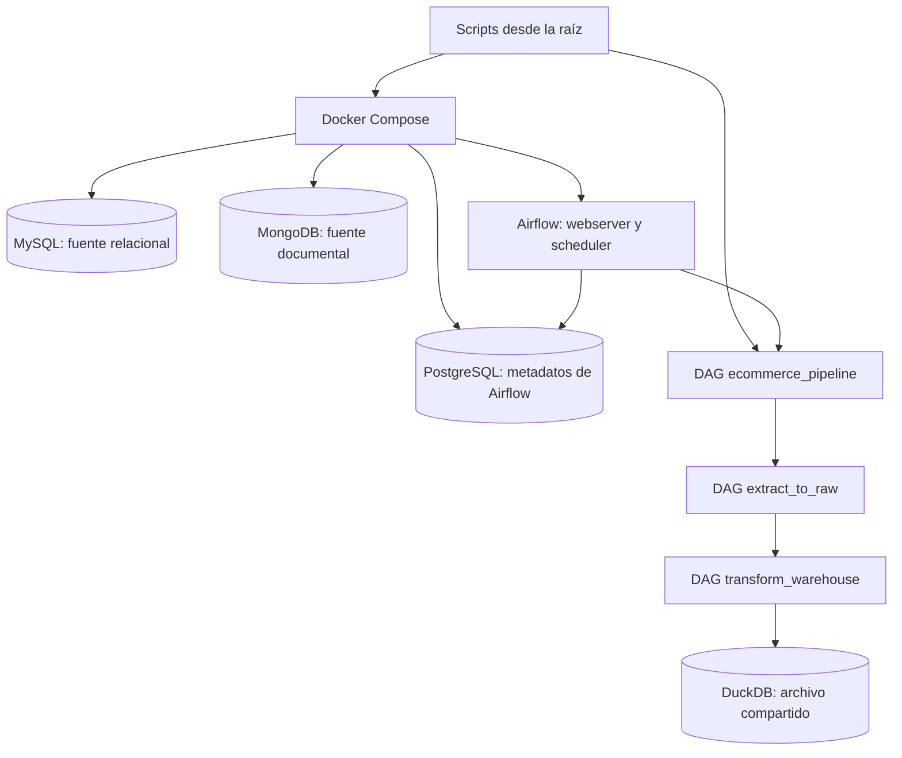
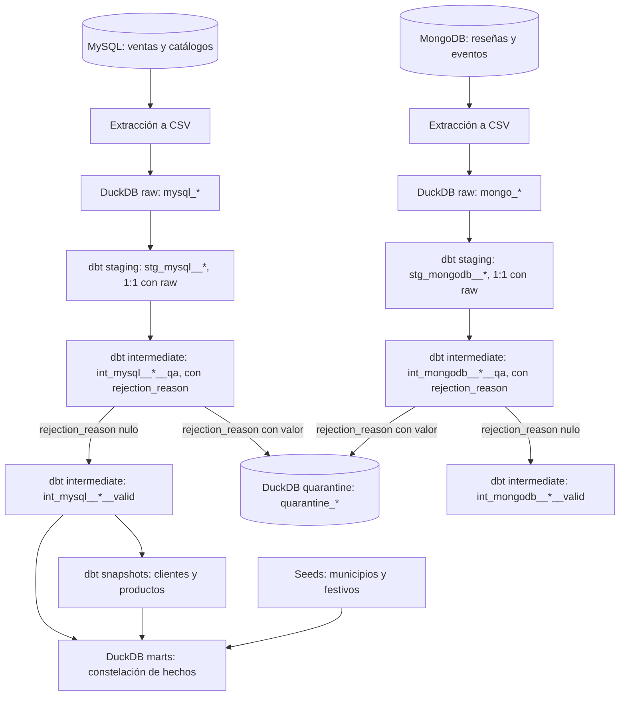

# Arquitectura

El proyecto separa las **fuentes operativas**, la **orquestación** y el **almacén analítico**. MySQL y MongoDB simulan sistemas que reciben datos del comercio. Airflow decide cuándo extraerlos y transformarlos; PostgreSQL guarda el estado de Airflow, no las ventas. DuckDB contiene los datos analíticos y dbt define cómo convertirlos en un modelo consultable.

## Componentes y responsabilidades

| Componente | Responsabilidad |
| --- | --- |
| `scripts/` | Prepara el entorno, administra Docker y ejecuta operaciones sobre las fuentes. `run_pipeline.sh` activa el flujo de Airflow; crear datos y simular cambios no requiere DAGs. |
| MySQL | Guarda clientes, productos, pedidos y líneas de pedido. Es la fuente de `fct_sales`. |
| MongoDB | Guarda reseñas y eventos de navegación con documentos anidados. Permite demostrar la ingesta semiestructurada. |
| Airflow | Programa y supervisa los DAGs `extract_to_raw`, `transform_warehouse` y `ecommerce_pipeline`. Ejecuta las tareas con `LocalExecutor`. |
| PostgreSQL | Persiste usuarios, definiciones registradas, corridas y estados de tareas de Airflow. No contiene datos del negocio. |
| DuckDB | Guarda `raw`, `intermediate`, snapshots y `marts` en un solo archivo local. |
| dbt | Define las transformaciones, conserva versiones de clientes y productos y ejecuta pruebas de calidad. |

`docker/docker-compose.yml` inicia los servicios. El contenedor `airflow-init` prepara los metadatos y el usuario administrador antes del webserver y el scheduler. Los DAGs están en `src/airflow/dags/`; sus funciones reutilizables, en `src/ecommerce_dw/`. El proyecto de dbt está en `src/dbt/`. [airflow.md](airflow.md) explica el funcionamiento interno de Airflow y las dependencias entre tareas.

## Recorrido de los datos

Las extracciones de ambas fuentes pueden ejecutarse a la vez y dejan CSV por corrida en `warehouse/extracts/`. Después, Airflow carga las tablas `raw` una detrás de otra y comprueba sus cantidades de filas. Cada carga reemplaza las tablas de su fuente dentro de una transacción. Raw conserva campos seleccionados y metadatos de carga; para MongoDB conserva además el documento completo en `document_json`.

### Diferencias entre raw, staging e intermediate

Las tres capas parten de la misma fuente y se parecen, pero cumplen funciones distintas:

| Capa | Dónde vive | Materialización | Qué contiene | ¿Guarda historial? |
| --- | --- | --- | --- | --- |
| raw (`mysql_*`, `mongo_*`) | esquema `raw` | tabla | Copia de la fuente, recargada completa en cada corrida | No: solo la última carga |
| staging (`stg_*`) | esquema `intermediate` | vista | Raw con tipos, `trim` y `nullif` | No: refleja raw |
| intermediate (`int_*__qa`, `int_*__valid`) | esquema `intermediate` | vista | Reglas de calidad y filas válidas | No |
| quarantine (`quarantine_*`) | esquema `quarantine` | tabla | Filas rechazadas con su motivo | Solo la corrida actual |
| snapshots (clientes y productos) | snapshots de dbt | tabla SCD2 | Versiones de cliente y producto | Sí |
| marts | esquema `marts` | tabla; hechos incrementales | Modelo estrella | Hechos: ventana reciente; dimensiones: snapshots |

Raw separa la extracción de la transformación y permite auditar qué llegó desde la fuente. Staging separa la limpieza técnica de la lógica de calidad. Intermediate concentra las reglas de negocio y de calidad. Las dos primeras capas no conservan historial; el historial de clientes y productos vive en los snapshots.

dbt prepara las tablas de MySQL hasta `int_mysql__*__valid`, registra versiones de clientes y productos en snapshots y construye `marts.fct_sales` con sus dimensiones. Las tablas de MongoDB llegan hasta `int_mongodb__*__valid` y alimentan `marts.fct_reviews` (una fila por reseña) y `marts.fct_navigation_events` (una fila por evento). Cada hecho tiene su propia granularidad y comparte con `fct_sales` las dimensiones conformadas de cliente, producto, fecha y canal. Los archivos de municipios y festivos entran mediante `dbt seed`. [data_model.md](data_model.md) detalla el destino de cada fuente y las reglas del modelo.

## Calidad de datos y cuarentena

dbt separa cada entidad en cuatro capas. Cada una tiene una responsabilidad distinta:

- `stg_<fuente>__<entidad>` (vistas, en `intermediate`): copia 1:1 de raw con tipos y nombres normalizados. No descarta filas, así que lo recibido de la fuente queda visible tal cual.
- `int_<fuente>__<entidad>__qa` (vistas, en `intermediate`): aplica las reglas de calidad a todas las filas y asigna `rejection_reason` con la primera regla que se incumple. Si ninguna se incumple, el valor es nulo.
- `int_<fuente>__<entidad>__valid` (vistas, en `intermediate`): solo las filas con `rejection_reason` nulo, sin esa columna. Son la entrada de snapshots, dimensiones y `fct_sales`.
- `quarantine.quarantine_<fuente>__<entidad>` (tablas): las filas rechazadas de `__qa`, con su motivo, para revisarlas o corregir la fuente.

Cada fuente cumple `raw = stg = qa` y `qa = valid + quarantine`. La tarea `dbt_run_quarantine` del DAG `transform_warehouse` materializa la cuarentena después de `intermediate`.

| Fuente | Reglas (en orden de prioridad) |
| --- | --- |
| `mysql_customers` | `missing_name`, `invalid_email` |
| `mysql_products` | `missing_category`, `negative_price` |
| `mysql_orders` | `orphan_customer`, `invalid_sales_channel`, `negative_total` |
| `mysql_order_items` | `orphan_order`, `orphan_product`, `invalid_quantity`, `subtotal_mismatch` |
| `mongo_reviews` | `invalid_rating`, `missing_reviewed_at`, `orphan_customer`, `orphan_product` |
| `mongo_navigation_events` | `invalid_event_type`, `missing_occurred_at`, `orphan_product`, `orphan_customer`, `invalid_sales_channel` |

Las reglas de huérfanos leen la capa `int_*__valid` del padre, así que una línea cuyo pedido se rechazó también se rechaza (cascada). En eventos, un cliente nulo es válido porque representa una visita anónima. Los valores permitidos de canal y tipo de evento se definen en `dbt_project.yml` (`valid_sales_channels` y `valid_event_types`).

`generate_data.sh --bad-records N` inyecta defectos controlados para probar la cuarentena. Cada unidad agrega registros inválidos en MySQL y MongoDB; por defecto son 2 unidades y `0` desactiva la inyección. Los defectos de MongoDB se insertan saltando el validador del servidor, como lo haría una importación externa.

## Archivos y persistencia

| En el repositorio | Dentro de Airflow | Propósito |
| --- | --- | --- |
| `src/airflow/dags/` | `/opt/airflow/dags/` | Definiciones de los DAGs. |
| `src/` | `/opt/airflow/src/` | Código Python y proyecto dbt. |
| `warehouse/warehouse.duckdb` | `/opt/warehouse/warehouse.duckdb` | Archivo del almacén analítico. |
| `warehouse/extracts/` | `/opt/warehouse/extracts/` | CSV temporales separados por corrida. |

MySQL, MongoDB, PostgreSQL y los logs de Airflow usan volúmenes de Docker. Detener los servicios conserva esos volúmenes y el archivo de DuckDB. `reset_environment.sh` elimina los volúmenes, el archivo analítico, las extracciones y los artefactos generados por dbt; `.env` permanece para la siguiente ejecución. Para abrir cada base desde una herramienta de escritorio, consulta [connections.md](connections.md).

## Ejecuciones repetidas y concurrencia

`run_pipeline.sh` crea el esquema, regenera los datos sintéticos iniciales y dispara el DAG maestro. Para conservar cambios ya hechos en las fuentes se usa `run_pipeline.sh --existing-sources`. El maestro espera primero la ingesta y luego la transformación; dbt carga seeds, modelos intermedios, snapshots, marts y pruebas en ese orden. Raw se refresca por completo, los snapshots conservan sus versiones y los tres hechos (`fct_sales`, `fct_reviews`, `fct_navigation_events`) son incrementales: seleccionan filas nuevas o recientes y retiran las que desaparecieron del origen (ver [carga incremental](data_model.md#carga-incremental-de-los-hechos)). `verify_incremental_load.sh --batch-id N` comprueba que repetir un lote no duplica ni reescribe hechos sin cambios; N debe ser un número que no se haya usado en ese entorno.

DuckDB admite un solo proceso escritor sobre el archivo. En los DAGs, las cargas raw y los comandos dbt se serializan y usan `warehouse/warehouse.lock`; las extracciones sí pueden correr en paralelo. El script manual `run_dbt.sh` ejecuta dbt directamente, por lo que debe usarse cuando ningún DAG esté escribiendo en DuckDB. Una conexión de escritorio al archivo también debe cerrarse antes de ejecutar el flujo si mantiene el archivo ocupado.
