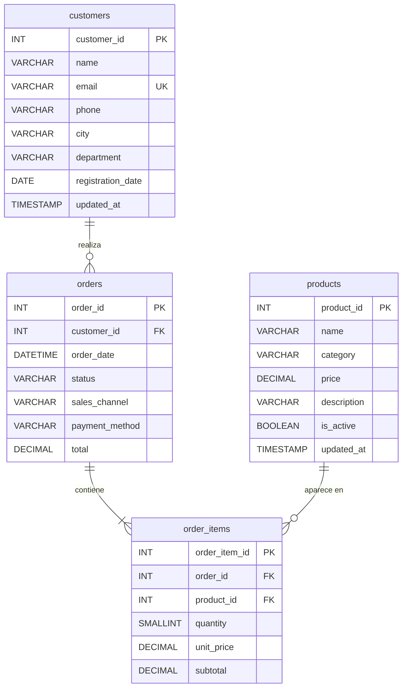
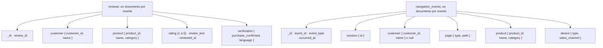
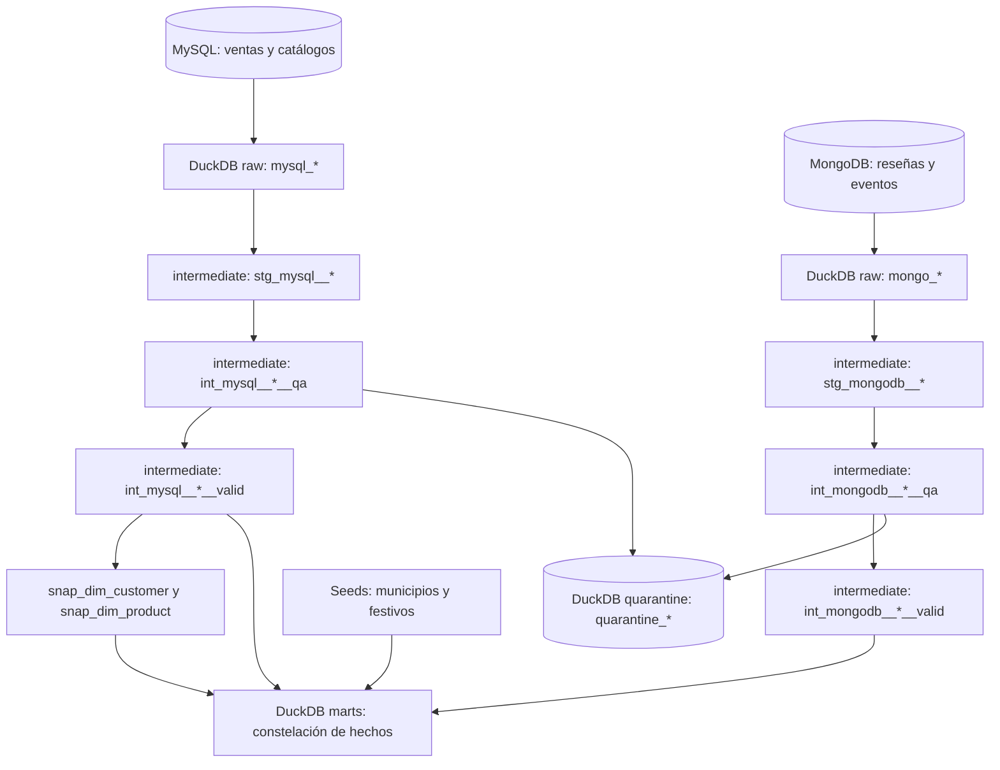
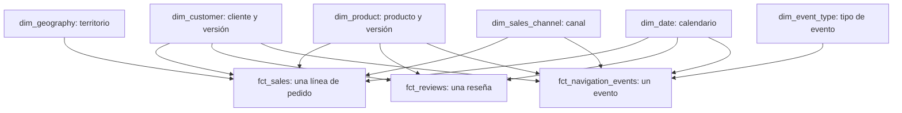
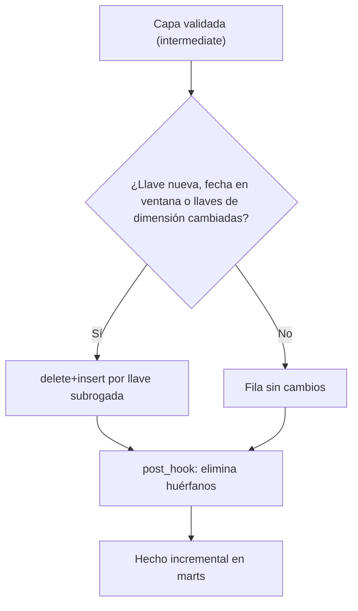

# Modelo de datos

## Qué queremos obtener

El ejercicio convierte datos operativos de un comercio electrónico colombiano en un modelo para responder preguntas de ventas: ¿cuánto se vendió por mes, departamento, canal o categoría?, ¿cuántas unidades se vendieron? y ¿qué versión de un cliente o producto estaba registrada cuando ocurrió una venta? El resultado de consulta es el esquema `marts` del archivo `warehouse/warehouse.duckdb`. MySQL y MongoDB son fuentes; PostgreSQL guarda solo metadatos de Airflow y no forma parte del warehouse.

La tabla central es `marts.fct_sales`. Su **granularidad** es una línea de pedido, no un pedido completo: si un pedido contiene tres productos, aporta tres filas al hecho. Por eso se suman `subtotal` y `quantity` de `order_items`; `orders.total` permanece disponible en la capa intermedia para contrastar el importe del pedido, pero no es una medida del hecho. Las dimensiones aportan el contexto necesario para agrupar esas líneas sin repetir atributos descriptivos en cada venta.

## Fuentes: qué representa cada registro

| Origen | Tabla o colección | Granularidad y campos principales | Uso actual |
| --- | --- | --- | --- |
| MySQL | `customers` | Una fila por cliente (`customer_id`), con nombre, contacto, `city`, `department`, `registration_date` y `updated_at`. | Alimenta el historial de `dim_customer`; ciudad y departamento permiten asignar `dim_geography` a la venta. |
| MySQL | `products` | Una fila por producto (`product_id`), con nombre, `category`, precio, descripción, estado y `updated_at`. | Alimenta el historial de `dim_product`. El precio cobrado en una venta procede de `order_items.unit_price`, no del precio actual del catálogo. |
| MySQL | `orders` | Una fila por pedido (`order_id`), vinculada a un cliente, con `order_date`, estado, `sales_channel`, `payment_method` y `total`. | Proporciona cliente, fecha y canal a cada línea de venta. `status`, `payment_method` y `total` quedan en la capa intermedia; no son columnas de `fct_sales`. |
| MySQL | `order_items` | Una fila por línea (`order_item_id`), vinculada a pedido y producto, con `quantity`, `unit_price` y `subtotal`. | Define las filas y medidas de `fct_sales`. |
| MongoDB | `reviews` | Un documento por reseña (`review_id`), con cliente y producto anidados, puntuación, texto, fecha y verificación de compra. | Se carga a `raw`, pasa por `stg_mongodb__reviews` y, si cumple calidad, por `int_mongodb__reviews__valid`. Alimenta `fct_reviews`. |
| MongoDB | `navigation_events` | Un documento por evento (`event_id`), con tipo y fecha, sesión, página, producto, cliente opcional y dispositivo anidados. | Se carga a `raw`, pasa por `stg_mongodb__navigation_events` y, si cumple calidad, por `int_mongodb__navigation_events__valid`. Alimenta `fct_navigation_events`. |

Las llaves `customer_id`, `product_id`, `order_id` y `order_item_id` son **llaves de negocio**: identifican registros en las fuentes y permiten reconstruir sus relaciones. Los documentos MongoDB contienen referencias a clientes y productos, pero una reseña o un evento no equivale a una línea vendida. Unirlos directamente a `fct_sales` multiplicaría filas y sumas cuando un producto tiene varias reseñas o visitas. Por eso cada proceso tiene su propio hecho: `fct_reviews` (una fila por reseña) y `fct_navigation_events` (una fila por evento). Ambos comparten dimensiones conformadas con `fct_sales`.

Dos archivos de referencia completan el modelo. `colombia_municipalities.csv` aporta la jerarquía `country` → `department` → `city` para `dim_geography`; `colombia_holidays.csv` señala los festivos que se incorporan a `dim_date`. Son **seeds** de dbt, no transacciones de las fuentes.

## Esquema de las fuentes

### MySQL: modelo relacional

El esquema se crea en [`schema.sql`](../src/ecommerce_dw/sources/mysql/schema.sql). Un cliente realiza pedidos, cada pedido tiene líneas y cada línea apunta a un producto. La restricción `uq_order_items_order_product` impide repetir un producto dentro del mismo pedido.



### MongoDB: documentos anidados

MongoDB no tiene relaciones entre colecciones: cada documento lleva dentro los datos del cliente y del producto que necesita. El campo `_id` es la llave del documento (`review-00000001`, `event-00000001`) y el número del campo `review_id` o `event_id` es la llave de negocio que se usa en el warehouse. El esquema de validación de cada colección está en [`generate_data.py`](../src/ecommerce_dw/sources/generate_data.py). En los eventos anónimos, `customer` vale `null`.



Ejemplo de una reseña (valores abreviados):

```json
{
  "_id": "review-00000001",
  "review_id": 1,
  "customer": { "customer_id": 47, "name": "Eugenia Marcela García Moreno" },
  "product": { "product_id": 22, "name": "Minima Juguetes", "category": "Juguetes" },
  "rating": 5,
  "review_text": "…",
  "reviewed_at": "2025-01-02 01:35:00",
  "verification": { "purchase_confirmed": false, "language": "es-CO" }
}
```

Ejemplo de un evento de navegación de un cliente identificado:

```json
{
  "_id": "event-00000001",
  "event_id": 1,
  "event_type": "agregar_carrito",
  "occurred_at": "2025-01-01 20:21:00",
  "session": { "id": "session-000122" },
  "customer": { "customer_id": 10, "name": "María Melissa Erazo García" },
  "page": { "type": "producto", "path": "/productos/19" },
  "product": { "product_id": 19, "name": "Maiores Libros", "category": "Libros" },
  "device": { "type": "escritorio", "sales_channel": "móvil" }
}
```

Las fechas de MongoDB se guardan en UTC. El pipeline las convierte a hora de Bogotá antes de asignar `business_date`, por eso la prueba `assert_mongo_facts_use_bogota_business_date` compara esas fechas.

## Del origen al destino



| Capa | Qué hace | Qué conserva |
| --- | --- | --- |
| `raw` | Airflow extrae cada fuente y carga seis tablas `raw.mysql_*` y `raw.mongo_*` en DuckDB. Repetir la ingesta reemplaza el contenido de cada tabla en una transacción. | Los campos seleccionados de cada fuente, `_loaded_at` y `_source`; las dos tablas Mongo guardan además `document_json` con el documento completo. |
| `stg_*` (intermediate) | Copia 1:1 de raw con tipos y nombres normalizados. No descarta filas. | Todas las filas de la fuente, sin filtrar. |
| `int_*__qa` (intermediate) | Aplica las reglas de calidad y asigna `rejection_reason`. | Todas las filas, con el motivo del primer rechazo cuando lo hay. |
| `int_*__valid` (intermediate) | Filtra las filas sin motivo de rechazo y quita esa columna. | Solo filas válidas. Alimenta snapshots, dimensiones y `fct_sales`. |
| `quarantine` | Guarda las filas rechazadas de `int_*__qa`. | Filas rechazadas con su motivo, para revisión o corrección en la fuente. |
| Snapshots | `snap_dim_customer` y `snap_dim_product` comparan atributos de clientes y productos entre ejecuciones. | Una versión por cambio detectado, con `dbt_valid_from` y `dbt_valid_to`. |
| `marts` | dbt construye tres hechos (`fct_sales`, `fct_reviews` y `fct_navigation_events`) y seis dimensiones para consulta analítica. | Medidas y referencias mediante llaves subrogadas. |

La separación permite inspeccionar lo recibido en raw, verificar su interpretación en los modelos `stg_`, revisar rechazos en `quarantine` y consultar una estructura estable en marts. Raw se refresca por completo; el historial de snapshots se conserva y los tres hechos son incrementales: seleccionan filas nuevas o recientes y retiran las que ya no existen en la fuente (ver [Carga incremental de los hechos](#carga-incremental-de-los-hechos)). Las consultas de negocio deben partir de `marts`, mientras que raw, staging y quarantine ayudan a rastrear el origen y diagnosticar diferencias.

Las reseñas y los eventos llegan hasta `int_mongodb__*__valid` y de ahí a sus propios hechos en `marts`, que reutilizan las dimensiones de cliente, producto, fecha y canal. Las fechas de MongoDB llegan como `TIMESTAMPTZ`; los hechos las convierten a hora de Bogotá antes de elegir la fecha de negocio y la versión vigente de cliente y producto.

## Constelación de hechos y destino de cada dato



| Hecho | Grano | Medidas | Llaves subrogadas |
| --- | --- | --- | --- |
| `fct_sales` | Una línea de pedido. | `quantity`, `unit_price`, `subtotal`. | `customer_sk`, `product_sk`, `sales_channel_sk`, `date_sk`, `geography_sk`. |
| `fct_reviews` | Una reseña. | `rating` (1 a 5) e `is_verified_purchase`. | `customer_sk`, `product_sk`, `date_sk`. |
| `fct_navigation_events` | Un evento de navegación. | Ninguna: es un hecho sin medidas, que cuenta eventos. | `customer_sk` (nulo si el evento no tiene cliente), `product_sk`, `date_sk`, `sales_channel_sk`, `event_type_sk`. |

`fct_sales` contiene `sale_sk`, las cinco llaves `customer_sk`, `product_sk`, `sales_channel_sk`, `date_sk` y `geography_sk`, y las medidas `quantity`, `unit_price` y `subtotal`. `sale_sk` identifica la línea y se deriva de `order_item_id`. El hecho no guarda `customer_id`, `product_id` ni otros identificadores de negocio: esos valores se consultan en las dimensiones. Esta separación evita mezclar la identidad de una entidad con la identidad de una versión histórica.

| Dimensión | De dónde sale | Para qué sirve |
| --- | --- | --- |
| `dim_customer` | Snapshot de `customers`. | Analizar ventas por cliente y por sus atributos vigentes en una versión concreta. |
| `dim_product` | Snapshot de `products`. | Analizar ventas por producto y categoría conservando cambios de catálogo. |
| `dim_sales_channel` | Valores distintos de `orders.sales_channel` y de los eventos de navegación válidos. | Comparar ventas y visitas por canal; muestra el valor actual, sin versiones históricas. |
| `dim_event_type` | Valores distintos de `event_type` en los eventos válidos. | Clasificar eventos de navegación; SCD tipo 1. |
| `dim_date` | Calendario fijo de `date_dimension_start` a `date_dimension_end` (2025-01-01 a 2027-12-31) y seed de festivos. | Agrupar por año, trimestre, mes, semana o día, y distinguir fines de semana y festivos. |
| `dim_geography` | Seed de municipios; la venta se vincula mediante ciudad y departamento del cliente. | Agrupar por país, departamento o ciudad. |

Así, una consulta agrupa `fct_sales.subtotal` por los atributos de una dimensión, por ejemplo mes o departamento.

Los tres hechos comparten dimensiones conformadas, así que pueden combinarse por **drill-across**: cada hecho se agrega por la misma llave (producto y mes, por ejemplo) y después se unen los resultados. Unir los hechos entre sí sin agregar antes multiplicaría filas. [analytical_queries.sql](analytical_queries.sql) contiene consultas reales de ventas por tiempo y territorio, del historial de un cliente y una comparación de ventas, reseñas y visitas por producto y mes.

## Historial, llaves y fecha de la venta

`dim_customer` y `dim_product` son dimensiones lentamente cambiantes de tipo 2 (SCD tipo 2). Cuando cambia un atributo vigilado, dbt conserva la versión anterior y crea otra. `valid_from` marca el inicio de una versión, que corresponde al `updated_at` de la fuente que originó el cambio; `valid_to` indica su cierre e `is_current` indica la versión abierta. Las llaves de negocio (`customer_id` y `product_id`) siguen identificando la misma entidad; `customer_sk` y `product_sk` distinguen sus versiones. dbt_utils genera `customer_sk` y `product_sk` con el nombre de la entidad, la llave de negocio y `dbt_valid_from`. El nombre de la entidad evita colisiones: sin él, el cliente 1 y el producto 1 producirían la misma llave si empezaron en la misma fecha.

Al construir `fct_sales`, dbt busca la versión de cliente y producto vigente en `orders.order_date` y guarda sus llaves subrogadas. `fct_reviews` y `fct_navigation_events` aplican la misma regla con la fecha local de la reseña o del evento. Los pedidos anteriores a la primera versión de un registro se asignan a esa primera versión (`first_valid_from`). La regla depende de que `updated_at` sea fiel: MySQL lo actualiza en cada `UPDATE` (`ON UPDATE CURRENT_TIMESTAMP`) y `simulate_changes.py` lo escribe explícitamente con `--changed-at`, de modo que `valid_from` refleja cuándo cambió el dato en el origen y no cuándo se ejecutó dbt.

`dim_sales_channel` y `dim_event_type` son SCD tipo 1: reflejan los valores presentes en cada ejecución sin mantener versiones previas. `dim_sales_channel` une los canales de pedidos y de eventos, así que sirve para comparar ventas y visitas con la misma clasificación. Todas las dimensiones tienen llaves subrogadas generadas con `dbt_utils.generate_surrogate_key`; en `dim_date` se deriva de la fecha y en `dim_geography` de país, departamento y ciudad.

## Configuración de los snapshots

Los archivos [`snap_dim_customer.sql`](../src/dbt/snapshots/snap_dim_customer.sql) y [`snap_dim_product.sql`](../src/dbt/snapshots/snap_dim_product.sql) usan los mismos parámetros de `config(...)`:

| Parámetro | Función en este proyecto |
| --- | --- |
| `unique_key` | Llave de negocio que identifica una entidad de la fuente: `customer_id` o `product_id`. No identifica una versión concreta. |
| `strategy='timestamp'` | Crea una versión nueva cuando la fila de la fuente tiene un `updated_at` posterior al de la versión guardada. |
| `updated_at='updated_at'` | Columna de la fuente que marca la fecha del cambio. dbt la usa como `dbt_valid_from` de la versión. |

Con esta estrategia, cualquier cambio en la fila de origen genera versión, y un cambio sin nuevo `updated_at` no la genera. Por eso `simulate_changes.py` actualiza `updated_at` junto con cada cambio. Cambiar la estrategia exige reconstruir los snapshots: un `dbt snapshot` sobre un historial creado con `check` no reasigna las fechas anteriores. dbt genera `dbt_valid_from` y `dbt_valid_to`; las dimensiones derivan de ellos `valid_from`, `valid_to` e `is_current`. Consulta la [referencia de snapshots de dbt](https://docs.getdbt.com/docs/build/snapshots).

## Carga incremental de los hechos

`fct_sales`, `fct_reviews` y `fct_navigation_events` son modelos `incremental` con estrategia `delete+insert` sobre su llave subrogada (`sale_sk`, `review_sk` y `navigation_event_sk`). Cada corrida sigue tres pasos:

1. **Selección de candidatas.** Entran tres grupos de filas:
   - Cada llave que aún no existe en el hecho.
   - Cada fila cuya `business_date` cae dentro de la ventana de reproceso: desde `incremental_lookback_days` (7 días) antes de la fecha máxima ya cargada. La ventana absorbe datos tardíos que llegan después de su día.
   - Cada fila cuyas llaves de dimensión resueltas cambiaron frente a lo guardado (`customer_sk`, `product_sk` y, en ventas, `geography_sk`). Así, si un cliente se muda, sus ventas anteriores al cambio se reapuntan a la versión vigente en la fecha de cada pedido, aunque caigan fuera de la ventana.
2. **Reemplazo.** `delete+insert` borra las filas candidatas que ya existen y las inserta de nuevo. Repetir la corrida con los mismos datos produce el mismo resultado.
3. **Limpieza de huérfanos.** El `post_hook` `delete_orphaned_facts` borra las filas cuya llave de origen ya no está en la capa validada, de modo que una eliminación en la fuente también llega al hecho.



La lógica vive en las macros [`incremental_candidate_filter` y `delete_orphaned_facts`](../src/dbt/macros/incremental.sql). Las dimensiones no son incrementales: los snapshots ya conservan su historial.

Verificación: después de un cambio SCD2, el hecho incremental quedó idéntico a un full refresh de los tres hechos (mismo hash de contenido), y una segunda corrida no modificó nada.

Un **full refresh** (`dbt run --full-refresh`) reconstruye los hechos desde cero. Es necesario cuando cambia la forma de una llave subrogada de una dimensión, como ocurrió con la corrección que agregó el nombre de la entidad a `customer_sk` y `product_sk`. Las filas antiguas conservan la llave anterior y la ventana incremental no las vuelve a tocar.

## Calendario, geografía y comprobación

`dim_date` usa `dbt_utils.date_spine` sobre el rango fijo definido en `dbt_project.yml` (`date_dimension_start` y `date_dimension_end`, este último exclusivo). No depende de los pedidos, así que cubre cualquier fecha de venta futura dentro del rango. Incluye año, trimestre, mes, semana, día de la semana, fin de semana y festivos de `colombia_holidays`, que cubre 2025 a 2027. Las pruebas `assert_dim_date_covers_configured_range` y `assert_every_year_has_holidays` verifican el número de días y que cada año tenga festivos. Las fechas de MySQL (`order_date` y `updated_at`) se interpretan en hora de Bogotá (`business_timezone`). `dim_geography` representa la jerarquía país → departamento → ciudad del seed `colombia_municipalities`. La venta usa la ciudad y el departamento de la versión de cliente asociada; por eso ambas dimensiones se resuelven antes de insertar el hecho.

Las pruebas de dbt comprueban llaves únicas y obligatorias, relaciones de las llaves de cada hecho con sus dimensiones, rangos (`rating` entre 1 y 5) y valores aceptados para canal y tipo de evento. Las pruebas singulares `assert_sales_dates_match_raw_order_dates` y `assert_mongo_facts_use_bogota_business_date` verifican que las fechas de venta coinciden con `raw` y que los hechos de MongoDB usan la fecha de Bogotá. La calidad se puede contrastar además con dos igualdades: `raw.mysql_order_items` = `intermediate.int_mysql__order_items__qa` = `__valid` + `quarantine`, y el conteo y la suma de `subtotal` de `marts.fct_sales` deben igualar las líneas de raw menos las que están en cuarentena. Sin defectos inyectados (`--bad-records 0`), la cuarentena queda vacía y el conteo coincide con raw. `orders.total` permite revisar que cada cabecera concuerde con sus líneas. El script [`verify_incremental_load.sh`](../scripts/verify_incremental_load.sh) añade un lote, repite el mismo lote y verifica que los tres hechos no crezcan ni se reescriban filas sin cambios.
