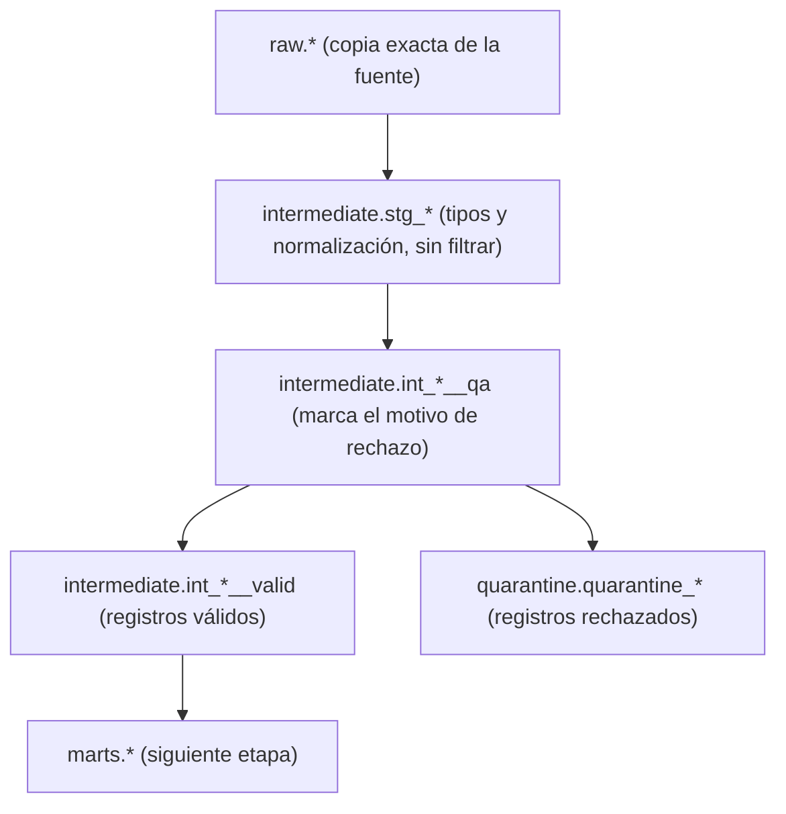

# Etapa 4: Calidad de datos y cuarentena

**Objetivo:** separar los registros válidos de los que no cumplen las reglas de calidad. Los válidos siguen hacia el modelo estrella; los rechazados quedan en el esquema `quarantine` con el motivo.

**Antes de empezar:** la [etapa 3](03_extraccion_raw.md) completa, con las tablas de `raw` llenas. Cierra DBeaver antes de ejecutar.

## Flujo de datos en esta etapa



- `stg_*` solo convierte tipos y normaliza texto (quita espacios, pasa el correo a minúsculas). **No elimina filas.** Por eso `raw` y `stg_*` tienen el mismo número de registros.
- `int_*__qa` calcula `rejection_reason` para cada fila. Es `NULL` si la fila es válida.
- `int_*__valid` solo deja las filas con `rejection_reason IS NULL`.
- `quarantine_*` guarda solo las filas con `rejection_reason IS NOT NULL`.

## Comandos

Esta etapa se ejecuta como parte del DAG `transform_warehouse`. Para correrla por separado desde la CLI:

```bash
docker compose --project-directory . -f docker/docker-compose.yml exec -T airflow-scheduler airflow dags trigger transform_warehouse
```

O desde la interfaz: abre <http://localhost:8080>, activa `transform_warehouse` y pulsa **Trigger DAG**. Las tareas que te interesan son `dbt_run_intermediate` y `dbt_run_quarantine`. Como el DAG completo también ejecuta snapshots, marts y pruebas, puedes ver el resultado de esta etapa en el log de esas dos tareas.

## Qué debes ver

En la vista **Graph** de `transform_warehouse`, `dbt_run_intermediate` corre antes que `dbt_run_quarantine`. Ambas tareas terminan en verde.

Conteos esperados con los valores por defecto (la suma de válidos y cuarentena es igual a la cantidad de `raw`):

| Fuente | Raw | Válidos | Cuarentena |
| --- | --- | --- | --- |
| MySQL `customers` | 54 | 50 | 4 |
| MySQL `products` | 27 | 25 | 2 |
| MySQL `orders` | 106 | 102 | 4 |
| MySQL `order_items` | 259 | 253 | 6 |
| MongoDB `reviews` | 158 | 150 | 8 |
| MongoDB `navigation_events` | 508 | 500 | 8 |

Los 32 registros en cuarentena son los defectos que inyecta el generador (ver [etapa 2](02_fuentes_iniciales.md)). Las dos filas restantes de las 34 inyectadas son cabeceras válidas que aíslan un defecto de subtotal, por eso no aparecen en cuarentena.

## Validar en DBeaver

Conecta DuckDB en modo solo lectura (ver [connections.md](../connections.md)).

Motivos de rechazo por tabla:

```sql
SELECT rejection_reason, COUNT(*) AS filas
FROM quarantine.quarantine_mysql__orders
GROUP BY rejection_reason
ORDER BY rejection_reason;
```

Con los valores por defecto, `quarantine_mysql__orders` muestra `invalid_sales_channel` (2) y `orphan_customer` (2).

Motivos posibles por tabla:

| Tabla de cuarentena | Motivos |
| --- | --- |
| `quarantine_mysql__customers` | `invalid_email`, `missing_name` |
| `quarantine_mysql__products` | `missing_category` |
| `quarantine_mysql__orders` | `invalid_sales_channel`, `orphan_customer` |
| `quarantine_mysql__order_items` | `orphan_order`, `subtotal_mismatch`, `orphan_product` |
| `quarantine_mongodb__reviews` | `invalid_rating`, `missing_reviewed_at`, `orphan_customer`, `orphan_product` |
| `quarantine_mongodb__navigation_events` | `missing_occurred_at`, `invalid_event_type`, `orphan_customer`, `orphan_product` |

Para ver una fila rechazada completa:

```sql
SELECT *
FROM quarantine.quarantine_mysql__customers
WHERE rejection_reason = 'invalid_email';
```

## Archivos implicados

| Archivo | Función |
| --- | --- |
| [src/dbt/models/intermediate/stg_mysql__orders.sql](../../src/dbt/models/intermediate/stg_mysql__orders.sql) | Ejemplo de staging: tipos y normalización, sin filtrar |
| [src/dbt/models/intermediate/int_mysql__orders__qa.sql](../../src/dbt/models/intermediate/int_mysql__orders__qa.sql) | Reglas de calidad y cálculo de `rejection_reason` |
| [src/dbt/models/intermediate/int_mysql__orders__valid.sql](../../src/dbt/models/intermediate/int_mysql__orders__valid.sql) | Filas válidas |
| [src/dbt/models/quarantine/quarantine_mysql__orders.sql](../../src/dbt/models/quarantine/quarantine_mysql__orders.sql) | Filas rechazadas |
| [src/dbt/models/quarantine/quarantine.yml](../../src/dbt/models/quarantine/quarantine.yml) | Descripción de las tablas de cuarentena |
| [src/dbt/dbt_project.yml](../../src/dbt/dbt_project.yml) | Materialización: `intermediate` como vista, `quarantine` como tabla |
| [src/ecommerce_dw/sources/generate_data.py](../../src/ecommerce_dw/sources/generate_data.py) | Genera los defectos que alimentan la cuarentena |

## Dónde cambiar

- Una regla de calidad nueva: en el archivo `int_*__qa.sql` de la fuente correspondiente.
- El nombre o las columnas de la cuarentena: en `quarantine_*.sql` y en `quarantine.yml`.
- Para que un defecto nuevo se genere en la fuente, modifica `generate_data.py`.

## Idempotencia

Las vistas de `intermediate` y las tablas de `quarantine` se recalculan completas en cada corrida. Ejecutar esta etapa dos veces no cambia los conteos.

## Siguiente etapa

[05_modelo_estrella.md](05_modelo_estrella.md)
