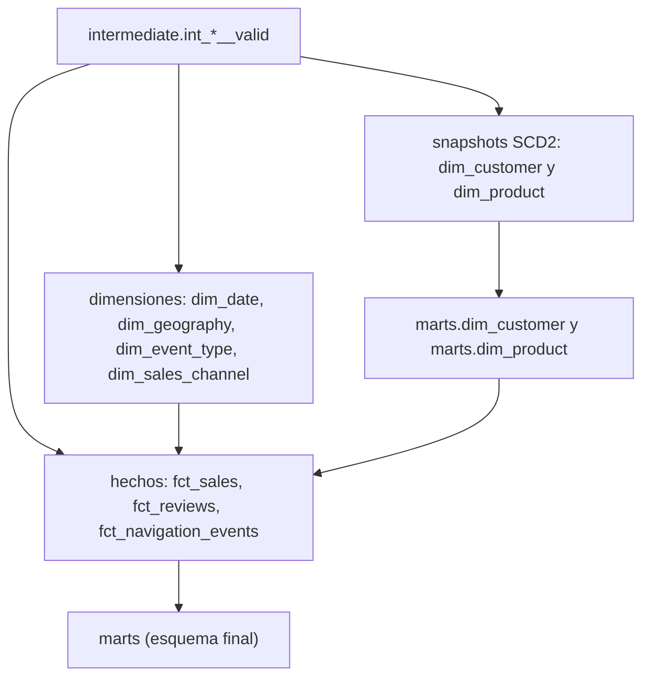

# Etapa 5: Modelo estrella

**Objetivo:** construir las dimensiones, los snapshots SCD tipo 2 y las tablas de hechos en el esquema `marts`, a partir de las filas válidas de la etapa 4.

**Antes de empezar:** la [etapa 4](04_calidad_cuarentena.md) completa.

## Flujo de datos en esta etapa



## Comandos

Se ejecuta con el DAG `transform_warehouse` (tareas `dbt_snapshot` y `dbt_run_marts`). Para la ejecución completa desde la CLI, usa `./scripts/run_dbt.sh`, que corre dependencias, seeds, intermediate, snapshots, marts y pruebas en ese orden.

## Qué debes ver

Conteos esperados con los valores por defecto, antes de aplicar cambios:

| Tabla | Filas | Notas |
| --- | --- | --- |
| `marts.dim_customer` | 50 | Una versión por cliente |
| `marts.dim_product` | 25 | Una versión por producto |
| `marts.dim_date` | 1095 | 2025-01-01 a 2027-12-31 |
| `marts.dim_geography` | 8 | Jerarquía país > departamento > ciudad |
| `marts.dim_event_type` | 3 | Tipos de evento de navegación |
| `marts.dim_sales_channel` | 3 | Canales de venta (SCD tipo 1) |
| `marts.fct_sales` | 253 | Una fila por línea de pedido válida |
| `marts.fct_reviews` | 150 | Reseñas válidas |
| `marts.fct_navigation_events` | 500 | Eventos válidos |

Los conteos de `dim_customer` y `dim_product` cambian cuando hay cambios en la fuente (etapa 8), y los de los hechos cuando se cargan lotes nuevos (etapa 9).

## Validar en DBeaver

Historia de un cliente con SCD tipo 2 (aparece después de la etapa 8; antes muestra una sola versión):

```sql
SELECT customer_id, city, department, valid_from, valid_to, is_current
FROM marts.dim_customer
WHERE customer_id = 1
ORDER BY valid_from;
```

Hechos sin llaves huérfanas (debe devolver 0):

```sql
SELECT COUNT(*) AS huerfanos
FROM marts.fct_sales f
LEFT JOIN marts.dim_customer c USING (customer_sk)
WHERE c.customer_sk IS NULL;
```

Totales de ventas, para comparar con MySQL:

```sql
SELECT COUNT(*) AS lineas, ROUND(SUM(subtotal), 2) AS total
FROM marts.fct_sales;
```

## Conceptos clave

- **Llave de negocio y llave subrogada:** `customer_id` es la llave de negocio, la que viene de MySQL. `customer_sk` es la llave subrogada que genera dbt con `generate_surrogate_key`. Los hechos solo guardan llaves subrogadas.
- **SCD tipo 2 (snapshots):** cada cambio de ciudad o categoría crea una versión nueva con `valid_from`, `valid_to` e `is_current`. La llave subrogada se construye con la llave de negocio, el nombre de la entidad y `dbt_valid_from`, así cada versión tiene su propia llave.
- **Resolución de versión en el hecho:** `fct_sales` elige la versión de cliente y producto que estaba vigente en la fecha del pedido.
- **SCD tipo 1 (`dim_sales_channel`):** se sobrescribe; no guarda historia.
- **Zona horaria:** las fechas de Mongo se convierten de UTC a `America/Bogota` en `marts`.

## Archivos implicados

| Archivo | Función |
| --- | --- |
| [src/dbt/snapshots/snap_dim_customer.sql](../../src/dbt/snapshots/snap_dim_customer.sql) | Snapshot SCD2 de clientes |
| [src/dbt/snapshots/snap_dim_product.sql](../../src/dbt/snapshots/snap_dim_product.sql) | Snapshot SCD2 de productos |
| [src/dbt/models/marts/dim_customer.sql](../../src/dbt/models/marts/dim_customer.sql) | Dimensión de clientes con llave subrogada por versión |
| [src/dbt/models/marts/dim_product.sql](../../src/dbt/models/marts/dim_product.sql) | Dimensión de productos con llave subrogada por versión |
| [src/dbt/models/marts/dim_date.sql](../../src/dbt/models/marts/dim_date.sql) | Dimensión de fechas (date_spine y festivos de Colombia) |
| [src/dbt/models/marts/dim_geography.sql](../../src/dbt/models/marts/dim_geography.sql) | Dimensión geográfica desde el seed de ciudades |
| [src/dbt/models/marts/fct_sales.sql](../../src/dbt/models/marts/fct_sales.sql) | Hecho de ventas, incremental |
| [src/dbt/models/marts/fct_reviews.sql](../../src/dbt/models/marts/fct_reviews.sql) | Hecho de reseñas, incremental |
| [src/dbt/models/marts/fct_navigation_events.sql](../../src/dbt/models/marts/fct_navigation_events.sql) | Hecho de eventos, incremental |
| [src/dbt/macros/scd2.sql](../../src/dbt/macros/scd2.sql) | Lógica de versión vigente por fecha |
| [src/dbt/macros/incremental.sql](../../src/dbt/macros/incremental.sql) | Filtro incremental y borrado de hechos huérfanos |
| [src/dbt/models/marts/marts.yml](../../src/dbt/models/marts/marts.yml) | Documentación y pruebas del modelo |

## Dónde cambiar

- Columnas de una dimensión: en su modelo dentro de `marts/`.
- Regla de versión (SCD2): en `snapshots/` y en `macros/scd2.sql`.
- Llave subrogada: en `dim_customer.sql` y `dim_product.sql`. Si cambias su fórmula, necesitas un `dbt run --full-refresh` (ver [etapa 9](09_carga_incremental.md)).

## Idempotencia

Las dimensiones se reconstruyen completas en cada corrida. Los hechos son incrementales (etapa 9), pero se llegan al mismo resultado si se repite la ejecución sin cambios en las fuentes.

## Siguiente etapa

[06_pruebas.md](06_pruebas.md)
